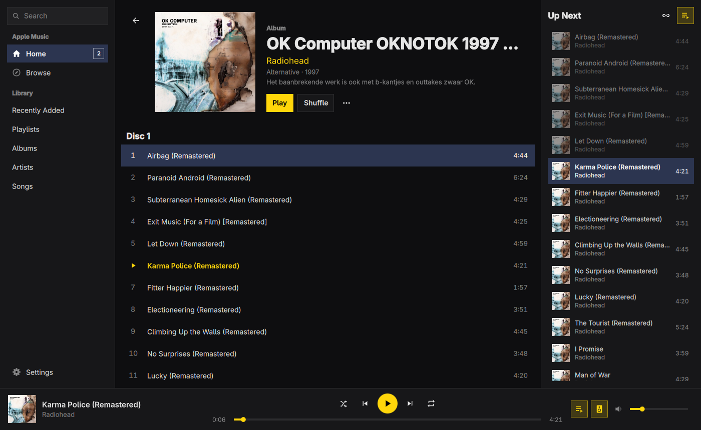

# Omasic



An Apple Music player for [Omarchy](https://omarchy.org). Browse your library,
discover music through Apple's recommendations, charts and stations, search
the catalog and play from the keyboard, in a window that follows the Omarchy
theme (light or dark, accent and corner rounding) and language.

Omasic is an independent project. It is not affiliated with, endorsed by or
supported by Apple. Apple Music and MusicKit are trademarks of Apple Inc.

- **Home**: recently played, Apple's recommendations for you, recent stations.
- **Browse**: the top songs, albums and playlists in your country.
- **Library**: recently added, playlists, albums, artists and songs.
- **Albums and playlists**: a header with Play and Shuffle; albums list their
  tracks by number and disc.
- **Now playing**: click the title or cover for its album, the artist for
  their page; shuffle, repeat, the queue, and the output device to play on.
- **Item menu** (right-click or M): play next, add to queue, add to library,
  favorite, suggest less, add to a playlist or a new one.
- **Visualizer** (V): the artwork's colors flowing through a grid of
  characters, moving to the bass, mids and highs of what's playing.
- **Autoplay**: keep playing similar music when the queue ends (∞ in the
  queue, or in Settings).
- **Settings** (Ctrl+,): autoplay, audio quality, the visualizer's controls,
  output device, Apple Music access, sign out.

## How it works

The window, library, search and controls are native Qt Quick, talking to the
Apple Music REST API. Apple Music streams are DRM-protected, so playback runs
through Apple's MusicKit JS in a hidden Qt WebEngine view with Widevine. That
view only shows itself for the Apple ID sign-in.

## Apple Music access

Apps that use Apple Music need a developer token. Omasic signs one with your
own MusicKit key, as Apple intends:

1. In an [Apple Developer](https://developer.apple.com) account, create a key
   under Certificates, Identifiers & Profiles, Keys, with MusicKit enabled.
2. Download its `.p8` file (Apple offers it once) and keep it somewhere safe.
3. Enter the Team ID, Key ID and the path to the `.p8` file when Omasic starts,
   or later under Settings.

The key stays on your machine; Omasic signs a token with it using `openssl`.

Without a developer account, Omasic can instead use the token of Apple's own
web player, if you choose that on the first screen or in Settings. Apple
doesn't sanction this for other apps: it can stop working at any time, and
Apple could block it. That token is cached in `~/.cache/omasic/omasic`.

Sign in with your password and two-factor code: Qt WebEngine's passkey support
doesn't work with Apple's sign-in page, so Omasic hides passkeys from it.

## Requirements

- An Apple Music subscription.
- A MusicKit key from an Apple Developer account (or the web player's token,
  see above), and `openssl` to sign with it.
- Widevine. On Apple Silicon running Asahi, that's the `widevine` package.
  Omasic looks for it in `/opt/WidevineCdm`, `/usr/lib/chromium/WidevineCdm`,
  `/opt/google/chrome/WidevineCdm` and `~/.local/lib`, and says so in the window
  when it can't find it.
- Qt 6 with WebEngine and WebChannel, and Qt Shader Tools to build.

## Keyboard

| Key | Action |
| --- | --- |
| Space | Play or pause |
| N / P | Next / previous track |
| Shift+← / Shift+→ | Back or forward 10 seconds |
| S | Shuffle on or off |
| R | Repeat off, all or one |
| + / − | Volume up or down |
| U | Show or hide the queue |
| O | Choose the output device |
| V | Show or hide the visualizer |
| G | Visualizer: characters or plain light |
| A / Shift+A | Go to the playing album / artist |
| / or Ctrl+F | Search |
| 2–8 | Home, Browse, Recently Added, Playlists, Albums, Artists, Songs |
| ↑ ↓ ← → | Move through lists and shelves |
| Enter | Play or open the selection |
| Esc | Go back |
| M | Menu for the selection |
| F5 | Reload the page |
| Ctrl+, | Settings |
| ? | Show or hide the shortcuts |
| Q | Quit |

Media keys, `playerctl` and the Omarchy bar control Omasic over MPRIS.

The output device is switched with `pactl` (from `libpulse`): Qt WebEngine
plays to the system default, and Omasic moves its own stream to the device you
pick.

The visualizer hears the music the same way: playback is DRM-protected inside
the web engine, so `pw-cat` (from `pipewire`) records Omasic's own stream, and
only that one, while the visualizer shows.

## Build

```sh
bin/build      # build/omasic
bin/test       # unit tests, offscreen
bin/install    # makepkg -fsi, adds Omasic to the app launcher
```

## License

MIT. See [LICENSE](LICENSE).
